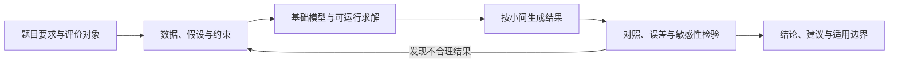

# 2021—2025 年 MCM / ICM 获奖论文：特点、优点与备赛方法

最值得学的，是把题目要求、模型选择、求解结果、可信度检验和实际建议连成一条清楚的分析链。不同获奖论文可以使用很不一样的算法；共同的学习价值在于，每个重要模块都有服务的问题，每个主要结论有对应的计算或观察证据。

## 1. 本次分析读了什么，结论能说明什么

分析日期：2026-10-09。资料来自本地“历年官方资料_2021-2025”。

- 对现有 **45 篇 Outstanding Winner（O 奖）论文**做逐页文本提取和结构检索：MCM A/B/C 共 30 篇，ICM D/E/F 共 15 篇。
- 对 **18 篇**代表论文重点阅读摘要、核心模型、验证或敏感性、模型评价等段落：五个年份各选一篇 A/B/C，另加三个 ICM 案例。不是对 45 篇逐篇逐字精读，也没有重新运行作者的程序。
- 对文本提取为空或重要图表所在的页面补做图像核对。页码均指本地 PDF 从第一页开始计数；论文自印页码可能不同。
- 奖项依据 COMAP 官方名单核实；全文来自公开第三方资料库，部分有水印。近年会员限定的 Judges’ Commentary 未获取。本报告的“共同特点”是论文观察与分析，不冒充评委对这些队伍的获奖理由。

这个样本倾向于含专项奖的 O 奖论文，没有随机抽样，也没有与同题未获 O 奖论文进行对照。因此，不能用它估计某种做法的获奖概率，或断言某个算法导致获奖。本文分别标明“原文观察”和“备赛建议”；检索命中也不等于相关工作做得充分。

官方当前指南强调摘要、合理且有依据的假设、模型动机、检验、优缺点、明确结果和资源引用。这给下文提供了外部参照，但并不是官方评分权重表。[COMAP 官方指南](https://contest.comap.org/undergraduate/contests/mcm/instructions.php)

## 2. 最值得迁移的八个共同特点

| 特点 | 论文中的优点 | 你参赛时应落实的动作 | 代表证据 |
|---|---|---|---|
| 按任务组织模型 | 评阅者容易找到每个小问的答案 | 给每个小问列出输入、输出、模型、结果图和结论 | 2022 B 2213970，p1、p5；2023 C 2314151，p1 |
| 模型与对象特征对应 | 方法选择有理由，模型能解释现实 | 写清对象的约束、数据形态和主要机制，再选模型 | 2022 A 2212245，p1、p4；2025 C 2513314，p5—6 |
| 假设参与建模，并暴露代价 | 简化过程可追踪，读者知道哪里可能失效 | 每个重要假设写理由、影响的公式及违反后的风险 | 2022 B 2213970，p5、p20—21 |
| 既报告结果，也说明结果含义 | 计算能支持题目的决策 | 把参数和图表译成“谁应该采取什么措施” | 2025 B 2501687，p17—20 |
| 主动检验结果 | 不只依靠漂亮拟合曲线或自我评价 | 按题型设计对照、留出数据、仿真或现实量级检查 | 2021 C 2107870，p19—21；2024 C 2401445，p19—21 |
| 敏感性分析服务于判断 | 能发现关键参数、政策优先级和适用边界 | 明确改什么、改多少、观察什么、结论是否改变 | 2021 A 2100454，p18—19；2025 B 2501687，p17—18 |
| 能说清局限，而不只是自夸 | 为解释失败与改进提供依据 | 报告不利案例、简化误差及外推风险 | 2024 C 2401445，p19—21；2024 E 2410889，p22 |
| 摘要和图表承担解释工作 | 用较少篇幅交代方法、结果和价值 | 摘要列主要结论；每张重要图回答一个问题 | 2023 C 2314151，p1；2025 C 2513314，p10—11 |

这些特点并非每篇都同样强。例如，有的论文验证较明确，有的主要依赖场景仿真；有的摘要有数值结果，有的偏方法概述。不要把上表理解为 45 篇全部满足的统一模板。

### 2.1 完成任务的逻辑，比算法名单更值得学习

**原文观察。** 2023 A 2303950 以植物生长为基础，逐步加入竞争和促进作用，再分析干旱与外部干扰。2022 B 2213970 从供水供电约束出发，再处理竞争利益和短缺分配。这些模块之间有承接关系。2021 C 2107870 则把图像、文字与时空信息的分工说明清楚，再综合用于调查优先级。

**优点。** 一个核心框架可以支持多个小问，前面的结果成为后面分析的输入，不容易出现“每个小问换一种算法，但最后相互无关”。

**备赛建议。** 先画一张依赖图，把小问和中间量连接起来。增加模型时，说明它补足哪个具体缺口。没有清楚用途的模块，即使名称高级，也值得删减。

### 2.2 模型要响应对象的性质

**原文观察。** 2025 C 2513314 从奖牌数的整数性质、总量约束、过度离散和国家差异出发，选择分层 Dirichlet–Multinomial 框架。2022 A 2212245 从人体能量供给、空气阻力、地形和转弯条件建立骑行策略。2022 C 2229059 使用交易信号和条件逻辑，把交易费、持有期与极端行情规则纳入策略。

**优点。** 模型中的关键关系能回到题目对象解释。贝叶斯模型、微分方程和规则策略都可出现在 O 奖论文中；算法复杂度并不是它们共同的尺度。

**备赛建议。** 在方法章节开头写三句话：对象具有哪些性质；这些性质为什么影响求解；所选模型如何保留它们。也要指出模型没保留什么。能在一小时内建立的合理基线，通常比长时间调不通的复杂方案更适合作为起点。这是工作建议，不是官方评奖规则。

### 2.3 好的假设应当能被追问

**原文观察。** 2021 A 2100454 承认部分参数带有人工设定性质，随后对生长速率比例和环境容量做范围扰动。2022 B 2213970 为忽略某些损耗等假设给出理由，也报告需求变化下原有均衡方案可能不再适用。

**优点。** 假设不是报告前面的装饰；它改变了公式或求解过程，也对应检验和边界。

**备赛建议。** 用四列管理假设：内容、理由、影响位置、检验方法。避免把“数据完全正确”“各变量相互独立”“全部影响已控制”直接当成事实。特别要区分“为了计算作出的简化”和“有资料支持的经验关系”。

### 2.4 将结果变成可执行的判断

**原文观察。** 2025 B 2501687 把游客数量、投资、资金分配和税收作为决策量，用敏感性结果给政策排序；换到九寨沟时，调整参数，并讨论政策重要性为何变化。2023 B 2300136 将保护区分成不同土地用途，设置不同权重和政策组合，而不是给整个区域一条统一建议。

**优点。** 决策建议能追溯到目标函数、约束和比较结果。模型回答了“应当怎么做”，而不只是“某个分数是多少”。

**备赛建议。** 写建议时采用：行动对象 → 可控制的变量 → 建议方向或范围 → 依据 → 条件与代价。所有模拟值都要标明为模型结果；不要把模型给出的政策数字包装成真实已执行的成效。

### 2.5 验证的设计应随题型改变

**原文观察。** 2021 C 2107870 展示三折交叉验证及混淆矩阵；2022 A 2212245 将模拟赛道和现实赛道作比较，并分析目标功率偏差与天气条件；2024 C 2401445 测试其他比赛，报告在一项赛事上的较低表现。2025 C 2513314 给出不同模型的比较表和不确定性区间，但本次未独立复现其中数值或完整评估协议。

**优点。** 验证可以回答“是否有效”“比什么好”“换条件后是否还有效”中的不同问题。它不是统一套一个 R² 或准确率。

| 任务 | 更有用的检验 | 常见误区 |
|---|---|---|
| 分类、调查优先级 | 留出数据；混淆矩阵；按错误代价解释精确率和召回率 | 类别极不均衡时只报准确率 |
| 时间预测、交易 | 按时间隔离评估；只用决策时已知信息；加入交易费和风险指标 | 用未来数据选参数，或只展示最终收益 |
| 机理模型、微分方程 | 单位与量级；已知案例；极限行为；数值步长与参数检查 | 曲线平滑就宣称模型正确 |
| 优化、政策选择 | 可行性；简单方案对照；不同目标的权衡；约束变化 | 启发式算法得到一个解就宣称全局最优 |
| 综合评价 | 指标与权重的依据；排序对权重变化的响应；外部资料核对 | 熵权或 AHP 自动保证评价客观 |

表中是从案例归纳后的备赛建议，并非每篇论文都完成了所有检验。对时序数据采用严格隔离、对同源图像防止数据泄漏等，是你应补强的验证设计，不能因为某篇获奖论文未充分交代就省略。

### 2.6 敏感性分析要解释“改变意味着什么”

**原文观察。** 2025 B 2501687 区分可控制的政策变量和估计参数：前者用于理解政策重要性，后者用于检查参数设定变化的影响。2024 B 2419984 改变阻力系数，比较轨迹偏移，并把偏移量放回搜索区域解释。2024 A 2424371 则展示宿主增长率变化可能对生态系统产生更大影响。

**优点。** 结果敏感有时意味着发现了关键机制，结果不敏感有时意味着结论稳健。两者都可能有价值，不能把“所有变量都不敏感”当成统一目标。

**备赛建议。** 区分三类对象：可采取行动的决策变量、存在估计误差的参数、可能变化的外部情景。围绕不确定来源选择扰动范围，报告结论是否改变、何处发生转折，以及实际影响多大。不要对全部参数机械地加减 10%，也不要因为一条曲线变化小就宣布整个模型适用于任何条件。

### 2.7 具体的失败案例比模板化的缺点更有价值

**原文观察。** 2024 C 2401445 在 p19 的表格中报告三场比赛的准确率为 0.83、0.85 和 0.58；p20 将较低表现讨论为可能与场地条件和训练数据差异有关。这里的解释是作者提出的可能原因，并未因此建立场地影响的因果证明。2024 E 2410889 承认用于指标赋权的资料主要来自中国，跨国应用需要补充数据。

**优点。** 读者知道模型的可靠范围，也知道下一步应采集什么资料。低表现不被隐藏，反而使改进方向更明确。

**备赛建议。** 用“限制 → 影响 → 改进”写局限。例如：少奖牌国家样本少 → 区间较宽或预测不稳定 → 单独检验该组，并考虑共享信息。不要只写“时间有限”“数据不足”；它们没有说明结论具体受到了什么影响。

### 2.8 摘要和图表要让人迅速判断论文做了什么

**原文观察。** 2023 C 2314151 的摘要按任务交代预测、词属性、难度分组和结果；2025 C 2513314 用模型比较表、奖牌预测图、区间和突破概率表组织信息。并非所有摘要都一样简练，论文的自我评价也不应直接当作分析结论。

**优点。** 模型名称与结果可以在同一位置找到。图表不是“展示用了很多方法”，而是帮助解释误差、政策差异或不确定性。

**备赛建议。** 完成主要结果后再定稿摘要，包含：核心任务、关键建模选择、最重要的定量或方向性结果、可靠性或边界、实际含义。每张重要图都配一句发现和一句解释。预测图标清区间含义，比较表使用一致数据和指标口径，地图和热力图标清量纲与图例。该摘要写法也符合官方当前指南。[COMAP 官方指南](https://contest.comap.org/undergraduate/contests/mcm/instructions.php)

## 3. 同题获奖论文的差异告诉我们什么

共同做法与个性亮点应分开学习。前者帮助搭建完整解题流程，后者需要根据题目与证据选择。

| 题型与案例 | 值得学习的特点 | 迁移时的边界 |
|---|---|---|
| 2021 A 真菌；2023 A 植物；2024 A 七鳃鳗 | 在生长、竞争、环境响应的机理框架上扩展，比较不同场景 | 需要说明参数来源及生态解释；仿真结果不是现场观测 |
| 2022 A 骑行 | 生理能量与运动力学相连接，再输出策略 | 不宜照搬某一种骑手的参数到所有人群 |
| 2021 B 山火；2024 B 潜水器搜索 | 把空间状态、资源限制和行动顺序相连 | 分辨定位误差、探测概率、路径目标与成本，别只画路线 |
| 2022 B 水资源；2023 B 保护区；2025 B 旅游 | 定义决策对象，处理竞争目标，比较情景或政策 | 权重、价值转换和外推参数需要依据，数学最优不等于政策可执行 |
| 2021 C 胡蜂；2023 C Wordle；2024 C 网球 | 特征、标签、任务与评估之间有对应关系 | 防止标签定义、样本划分和未来信息使用出现循环 |
| 2025 C 奖牌 | 利用整数、总量和异质性结构，表达预测不确定性 | 必须核对评估年份、基线公平性和区间生成方法 |
| 2021 D 音乐；2024 E 保险；2025 F 网络安全 | 将跨学科概念拆成指标、模型和建议 | 指标命名不是验证；复杂网络不是因果识别；仿真不是外部证据 |

这里没有固定的“获奖算法包”。2022 C 2229059 的交易逻辑和 2025 C 2513314 的分层概率模型都获 O 奖，但它们服务的是不同的数据约束和任务。更实用的学习问题是：作者为什么需要这个模块？如果删掉它，哪一项题目要求会受影响？

## 4. 获奖论文也不应照单全收

以下是阅读中需要保持的判断，不是对各队奖项的重新评定。

1. **相关、拟合和因果不能混写。** 2024 C 2401445 用无动量情景模拟与真实轨迹作比较，值得学习其对照思路；这种比较并非自动构成现实机制的严格证明。2025 F 2507789 使用政策评估和因果推断术语，也不能仅凭方法名称或“已控制混杂”的假设就确认因果效应。你应交代识别假设和支持它们的检验。
2. **稳健不等于准确。** 模型可能在多组参数下稳定地产生偏差。参数扰动应与留出数据、现实量级或独立资料检验互补。
3. **漂亮回测不等于未来可用。** 2022 C 2229059 明确强调逐日仅使用已知信息，并考虑交易费，这是值得学习的约束意识；本次没有重新运行程序，不能据此保证实际实现没有信息泄漏，也不能把其历史收益作为未来结果。
4. **专业名词和新颖包装不等于新知识。** 学习 2025 F 的跨维度组织方式时，要问变量和关系是否被数据支持。模型名字、文化隐喻或算法数量没有可直接复用的获奖效应。
5. **声明采集了数据，还需说明测量可靠性。** 2025 A 2511565 提供采样信息和阶梯照片，是比纯设想更具体的展示；但照片得到的相对深度如何标定为实际量、测量精度如何传播到结果，仍需检查。不要把“提出一种测量方案”写成“所有测量都实际完成”。
6. **历史论文版式不是当前提交规范。** 本包有超过 25 个 PDF 页面、后附 AI 使用报告的公开论文。不能根据总页数推断其违规，也不能直接照抄页数。当前官方指南要求主报告至多 25 页，包含摘要、参考文献和附录；使用 AI 时另附披露报告，其页数另计。提交前应再核对当届规则。[COMAP 官方指南](https://contest.comap.org/undergraduate/contests/mcm/instructions.php)

## 5. 转化为你能执行的备赛动作

### 5.1 优先练四件事

**第一：独立建立一个可运行的基础模型。** 选熟悉的旧题，先不看获奖答案。用少量可解释变量得到一版输出，逐项检查有没有回答题目。之后再读论文，比较问题拆分与假设，而不是照着复制代码或公式。

**第二：做一份有明确结论的验证。** 预测题留出时间或样本；机理题做现实量级和极限检查；决策题比较简单方案与约束变化。记录“检验前的期待”和“实际观察”，包括失败结果。

**第三：把两三张图和一张结果表讲清楚。** 给每张图写结论、依据及意义。把主要数字连接到题目要求；减少无法解释的图和无依据的小数位。

**第四：写一页摘要和一段局限。** 摘要先讲产出，再讲方法；局限说明影响范围。让队友只看摘要，复述你解决了什么、得到了什么、为什么可以相信。如果复述不出来，先改表达。

### 5.2 推荐阅读顺序

| 顺序 | 论文 | 重点学什么 | 阅读后应做的产出 |
|---|---|---|---|
| 1 | 2025 B 2501687 | 目标、决策变量、约束、敏感性如何支持政策 | 一张“变量—行动—依据”表 |
| 2 | 2024 C 2401445 | 如何设计对照、报告跨场景表现及失败 | 一份验证方案和一段失败案例解释 |
| 3 | 2021 C 2107870 | 多种数据如何分工、融合与评估 | 一张数据流程图和防泄漏检查表 |
| 4 | 2021 A 2100454 或 2022 A 2212245 | 机理、参数、场景与策略的连接 | 一份假设表和参数来源表 |
| 5 | 2022 C 2229059 | 规则策略也能形成完整建模分析 | 一个可运行基线和决策时序说明 |
| 6 | 2025 C 2513314 | 分布性质、基线比较、不确定性区间 | 同一评估口径下的对照表；不必先复刻复杂模型 |

### 5.3 三人团队的工作接口

分工按交付物协作，模型、程序和文字需要持续对齐。

- 模型负责人交付：小问映射、假设、公式、输入输出与检验需求。
- 数据与程序负责人交付：数据清洗记录、运行结果、可重复的检验及带单位的图表。
- 写作与复核负责人交付：连贯正文、摘要、引用和“结论有没有对应结果”的核对。

每次交接都记录变量名、单位、数据版本、运行条件和图表编号。例如写作方不能把“训练集拟合度”改成“预测准确率”，程序方也不能修改公式后不通知模型方。每个主要结论至少经过另一位队友复核。

### 5.4 比赛过程中设置四个检查点

下面是建议的进度检查，不是 COMAP 的时间要求；写作应从建模开始同步进行。

| 检查点 | 应拿得出的东西 | 若没有，应优先处理什么 |
|---|---|---|
| 工作时间约四分之一 | 题目要求映射；可运行基线；一版结果 | 缩减模型规模，排查数据和约束 |
| 工作时间约五分之三 | 各主要小问的结果；核心图表 | 补齐任务，停止无目标地增加算法 |
| 工作时间约五分之四 | 验证、敏感性、边界；可读正文 | 检查关键结论；留下必要重算时间 |
| 工作时间约十分之九 | 定稿摘要；数字与公式核对；可打开的 PDF | 解决提交格式和结果一致性问题 |

保留阅读、休息、异常修复和提前提交的时间。在当届允许的工作截止时间前结束修改。

## 6. 自查优先级：哪些最值得投入时间

以下排序是基于本次论文阅读的备赛判断，没有官方权重或获奖概率含义。

| 优先级 | 检查项 | 达到什么状态才算有进展 |
|---|---|---|
| P0 | 任务完成与计算正确 | 每个要求有回应；单位、约束、公式与代码相符 |
| P0 | 主要结论有依据 | 结果可追溯；预测与事实、训练与测试、仿真与观测分清 |
| P1 | 检验与适用边界 | 有对照或检验；知道哪些条件会影响结论 |
| P1 | 摘要与正文可读 | 能迅速看懂问题、方法、结果及意义 |
| P2 | 有用的扩展或新见解 | 加入后改善解释、决策或可靠性，且证据充分 |
| P2 | 版式精修 | 重要图清楚；信息密度合适；符合提交规则 |

完整性、可信度和表达应先形成底座，再追求题目相关的亮点。没有实证依据的复杂扩展、仅为凑章节的敏感性分析、无法解释的高精度数字，都应减量。

## 7. 证据与阅读边界

本目录同时提供：

- [代表论文学习卡与原文入口](02_代表论文学习卡_可点击原文.md)及 `02_18篇代表论文学习卡.csv`：逐篇特点、优点、可迁移动作、边界和 PDF 页码。
- `03_参赛前与提交前自查清单.md`：可直接用于组队训练和提交复核。
- `45篇论文结构检索.csv`：全部 45 篇的检索定位。它是阅读辅助表，不能当作质量评分或“缺少某章节”的判定。
- `证据/逐页文本` 与 `证据/页面核验`：供回查。提取为空可能是图像页，不代表原论文没有内容；有疑问应回到 PDF。

本报告没有核验全部参考文献、重新实现作者算法或独立确认其数值结果。文中报告的论文结果属于“作者报告”，推荐操作属于“本次归纳”；对结果的解释不能超出验证提供的证据。

### 报告自身的五项复核

| 维度 | 自查问题 | 本次处理 |
|---|---|---|
| 分析贡献 | 是否能转成参赛动作？ | 每个共同特点对应动作，另提供阅读顺序与清单 |
| 写作清晰 | 是否把官方规则、论文观察和建议混在一起？ | 分开标注；未虚构官方权重 |
| 证据强度 | 是否把获奖、作者自评当成模型正确的证明？ | 限定为案例观察，明确没有独立复算 |
| 覆盖完整性 | 是否以少数 C 题概括全部竞赛？ | 跨五年 A/B/C，并加入三个 ICM 案例；声明样本偏向 |
| 分析有效性 | 是否承认缺少对照样本与近年评委点评？ | 明示局限，不推断获奖原因或概率 |

原始 PDF 与页码链接列在代表论文学习卡中。与奖项有关的依据，可回查资料包中每年保存的 COMAP 官方获奖名单和结果报告。
